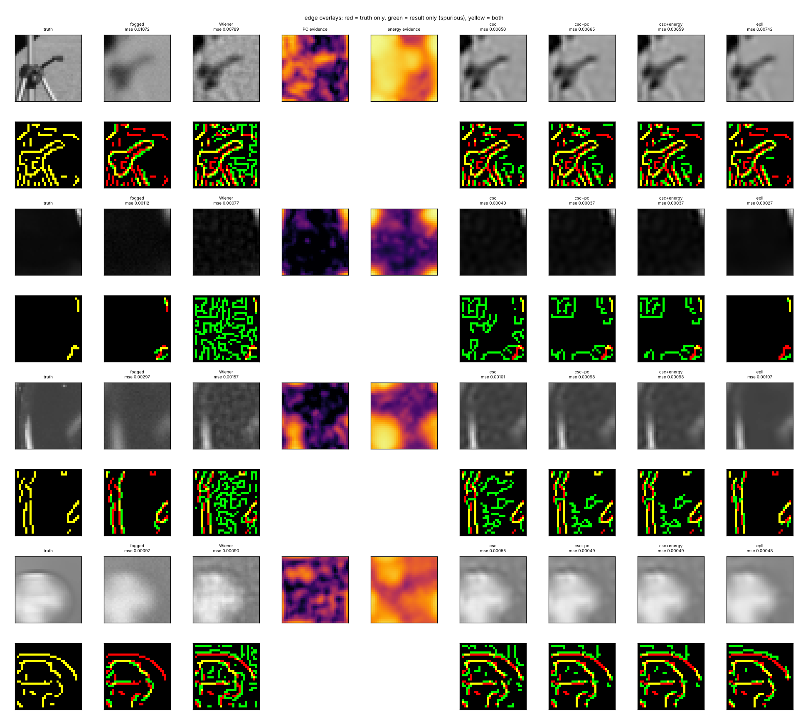

# Sihtiimagemodel7 — a reason to stay silent

**Model 6's competing atoms, given evidence for when to fire (cross-scale phase congruency on a
complex steerable pyramid), a memory (Model 5's living paper), and a control for whether the
learned world matters at all. Plus a live viewer of the "basis showing through": a migraine-aura
front crossing a modelled cortex.** CPU only, no pretrained network, no labels.

Preregistration: [docs/PREREG.md](docs/PREREG.md), including Amendment 1 (a change of the gate
selection rule after validation stage 1, disclosed with the reason), all committed before the test.
Every parameter came from validation only (`params.json → model7.log`).

## Where this comes from

Model 6 found that atoms competing for one picture see through fog better than everything it
tried, and failed for one reason: they write faint atoms into flat regions where the fog left only
noise (10–13 % spurious edges vs EPLL's 4 %), and those atoms flicker. Two candidate reasons to
stay silent came out of the Nov 1 conversation:

* **in space: cross-scale phase congruency.** A real edge has the same local phase at every scale
  (Morrone & Owens 1987; Kovesi 1999); noise does not. This is what the "cross-scale phase
  congruence map" in Janus/`attenuation.py` was reaching for, computed on the image's own local
  phase instead of on hidden activations.
* **in time: memory** that carries the picture forward and checks it against the present.

And one control, from the review of `attenuation.py`: fitting a stream "into a learned world" only
means something if a world learned from the wrong images fits worse.

## Instruments

* **`pyramid.py`**: undecimated complex steerable pyramid, 3 scales × 4 orientations. Tight frame
  (exact reconstruction and energy preservation, tested). **Phase is position**: a grating shifted
  by d moves its band phase by exactly f·d (tested to 10⁻⁶). The real cross-scale lock for a shift is
  φ_s = ω_s·d, phases growing with frequency, not equal angles across bands.
* **The gates** take evidence from the *Wiener estimate* of the observation, never from CSC's own
  output, so a gate cannot confirm its own hallucinations. An atom costs `1 + κ(1 − evidence)` times
  more where the evidence shows no feature. Two kinds of evidence, otherwise identical: **phase
  congruency** (with Kovesi's noise threshold) and **local oriented energy**. Both thresholds are
  in units of what the Wiener estimate of pure noise produces.
* **`paper.py`**: motion estimated from the fogged data alone (correct in every validation step),
  transport, per-pixel precision, a likelihood-ratio trust check, memory entering the same
  objective as a quadratic term.

## Results (64 test crops of three unseen photographs; 24 camera pans)

| Gate | Result | |
|---|---|---|
| **S1** phase congruency gives silence, heat fog | spurious edges in flat regions **12.9 % → 9.0 %**, MSE unchanged (0.001632 vs 0.001631), recall −1.3 pts | **PASS** |
| **S1** same, Sihti fog | **10.1 % → 7.3 %**, MSE 0.001817 vs 0.001829, recall −1.2 pts | **PASS** |
| **S2** it is the *phase*, not the energy, heat | PC 9.0 % vs energy 9.4 % (needed ≤ 0.9×) | **FAIL** |
| **S2** same, Sihti fog | PC 7.3 % vs energy 7.7 % | **FAIL** |
| **W1** the learned world matters | natural vs Janus-A/B world: **0.96×** MSE (CI 0.94–0.98; needed ≤ 0.9); vs random atoms 0.84× | **FAIL** |
| **T1** memory: calmer *and* better | flicker **0.0145 → 0.0052** (−64 %); late-frame MSE **0.87×** (CI 0.79–0.92) | **PASS** |
| **T2** a foreign memory is switched off | with trust: 1.000× per-frame (trust ≤ 2·10⁻²²); without: **32.8×** | **PASS** |

Context, heat fog (same test, Model 6's arms):

| Arm | MSE | edge precision | edge recall | flat-region spurious | flicker |
|---|---:|---:|---:|---:|---:|
| Wiener | 0.00228 | 0.52 | 0.94 | 24.2 % | — |
| independent patches | 0.00202 | 0.72 | 0.89 | 9.3 % | 0.0132 |
| EPLL (Model 4's states) | 0.00183 | **0.91** | 0.78 | **3.6 %** | — |
| CSC (Model 6) | 0.00163 | 0.66 | **0.91** | 12.9 % | 0.0145 |
| CSC + phase-congruency gate | 0.00163 | 0.73 | 0.90 | 9.0 % | — |
| CSC + energy gate | **0.00162** | 0.72 | 0.90 | 9.4 % | — |
| CSC + living paper (frames 3–5) | **0.00147** | | | | **0.0052** |



### What this says

**Evidence buys silence for free, but it isn't the phase.** Both gates cut the hallucinated
edges by about 30 % at no cost in error, on both fogs. Phase congruency and plain local energy do
almost exactly the same thing. The report-only frontier (`results/frontier_*.png`) shows the same
curve: at matched error the two gates reach the same silence (Sihti fog: PC κ=4 gives 5.0 % at
MSE 0.00183; energy κ=16 gives 5.0 % at 0.00183). On 32×32 crops with three undecimated scales,
congruency is a weak signal: pure noise already scores 0.74 before the threshold, and an ideal
edge 0.97. So "phase congruency is the reason to stay silent" is **not** shown. "Noise-calibrated
evidence from the observation is a reason to stay silent" is. Neither gate reaches EPLL's precision
(3.6 %); pushing either harder costs recall and error.

**The world is mostly "has oriented edges".** A dictionary learned from Janus's two synthetic
images (rings, a cross on a checkerboard) explains unseen photographs within 4 % of a dictionary
learned from natural photographs. Random atoms are 16 % worse. What the fitting needs is oriented,
localized, multi-phase atoms; where they were learned matters little at this scale. This is the
`attenuation.py` control answered: a model that fits a webcam frame well has not shown that it
fits it *into its world*, because almost any edge world fits.

**Memory is the strongest single thing here.** Carrying the picture forward cuts late-frame error
13 % below per-frame CSC and flicker by 64 %. Model 6's temporal failure is fixed: flicker now sits
below independent patches (0.0052 vs 0.0132). The trust check cost nothing on true histories and
switched every foreign history off completely. Without it, a foreign memory makes the answer 33×
worse.

**But calm is not correct.** In `results/paper.png` the memory keeps the faint hallucinated
atoms *in place* across frames instead of removing them: they stop flickering because they become
consistent. The error still falls, because memory also averages out the noise in what is real, but
part of the flicker win is persistence of mistakes. Silence in space (the gates) and memory in
time were tested separately here; combining them is the obvious next run.

**Position as phase (report only) lost.** Moving the memory by advancing every band's phase by
ω_s·(d·direction) instead of shifting pixels made things worse than no memory (MSE 0.00201 vs
per-frame 0.00170; flicker 0.0080). The phase advance is exact only for narrow bands; these bands
are an octave wide and the crops are 32 px with circular wraparound. Phase-as-position works per
band (tested), but transporting a whole picture through it needs narrower bands or a larger canvas.

### Caveats

* 32×32 grey crops, three test photographs, known noise level, integer camera pans.
* Gate settings: the heat-fog PC gate and the energy gates sit on grid edges (recorded). S1 used
  the claim-matched selection rule of Amendment 1; under the original MSE rule both gates would
  have been nearly off.
* The Janus-world result was already visible on validation and was disclosed before the test.

## The aura viewer — `docs/index.html`


A spreading-depolarization front moves across a flattened model of left V1 at about 3 mm/min
(Lashley 1941; Hadjikhani et al. 2001), mapped to the visual field by the complex log map
`w = 17.3·log((z + 0.75°)/0.75°)` mm (Horton & Hoyt 1991). That is why the crescent widens and
speeds up as it drifts outward, and why it stops at the vertical meridian. Each patch of cortex
prefers one orientation (a pinwheel map, drawn three times wider than real so a column covers more
than a pixel). At the front, each patch shows the **learned atom** it codes for, the 64 atoms Model 6
learned from photographs, sized by cortical magnification. Behind the front, a blind patch fills
in and heals. The shimmer is deliberately slow (under three changes a second) and stops under
reduced-motion settings. It is a model made to show the idea, not a medical description.

Run it on the webcam: open **https://anttiluode.github.io/Sihtiimagemodel7/** (published by the
repo's Pages workflow) and press **Use camera**. Or open `docs/index.html`
locally and use a photo. Rebuild after changing atoms: `python web/build.py`.

## Run it

```bash
pip install -r requirements.txt pytest
python -m pytest -q                    # 21 tests: pyramid exactness, phase = position, congruency,
                                       # gates, motion, transport, trust, Model 6's own tests
python tune7.py && python tune7_stage2.py   # validation only (about 1.5 h on 2 cores)
python run7.py                         # the preregistered test -> results/ (about 45 min)
```

| File | What |
|---|---|
| `pyramid.py` | complex steerable pyramid, local phase, congruency, energy |
| `gate.py` | evidence from the Wiener estimate; CSC with silence weights and a memory term |
| `worlds.py` | the natural, Janus-A/B and random worlds |
| `paper.py` | motion, pixel and phase transport, trust, the living paper |
| `run7.py`, `figures7.py`, `results/` | test, gates, figures, `metrics.json` |
| `tune7.py`, `tune7_stage2.py`, `params.json` | validation tuning and its full log |
| `web/`, `docs/index.html` | the aura viewer (source, atoms, build script; Pages copy) |
| `fog.py`, `models.py`, `metrics.py`, `bench.py`, `data.py`, `figures.py` | vendored from Model 6 |

Prior art: complex steerable pyramids (Simoncelli & Freeman 1995; Portilla & Simoncelli 2000),
phase congruency (Morrone & Owens 1987; Kovesi 1999), phase-based motion (Wadhwa et al. 2013),
convolutional sparse coding and LCA (Rozell et al. 2008), motion-compensated recursive estimation
(Kalman filtering with a spatial prior), cortical magnification (Horton & Hoyt 1991), migraine aura
and spreading depolarization (Lashley 1941; Hadjikhani et al. 2001; Richards 1971 on fortification
geometry).
